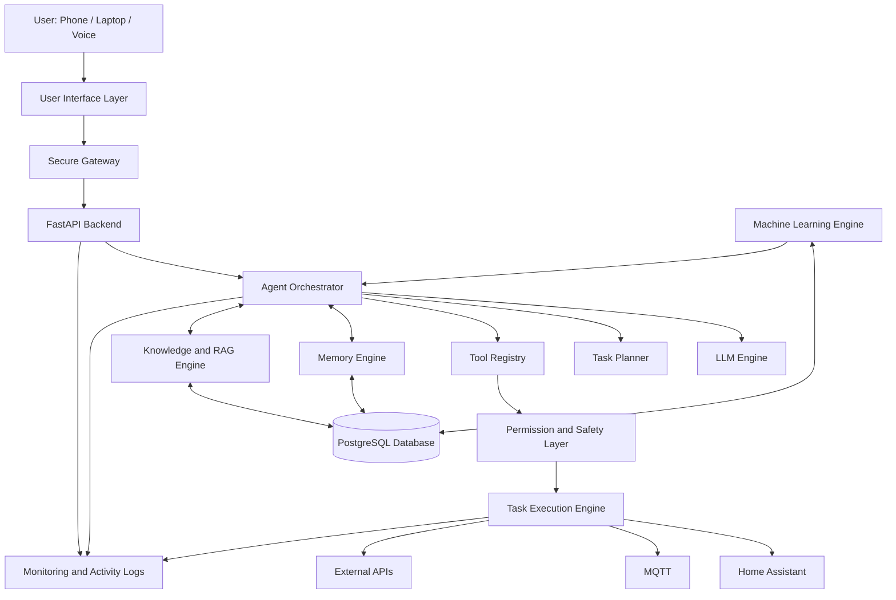
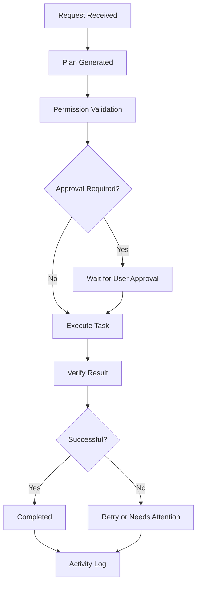
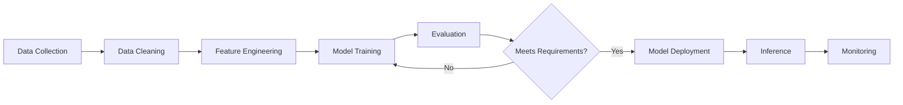
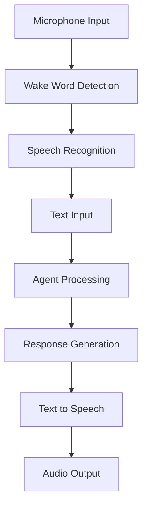

# N.E.X.U.S. — System Architecture

**Project:** A.R.K.  
**Full Form:** Neural Engine for eXploration, Understanding & Smart-home orchestration  
**Document Type:** Technical Architecture  
**Status:** Proposed Architecture  
**Version:** 1.0

---

# 1. Overview

N.E.X.U.S. is designed as a modular, AI-powered personal assistant that combines agentic AI, large language models, machine learning, contextual memory, voice interaction, task automation, and smart-home integration.

Unlike a conventional chatbot, N.E.X.U.S. is intended to interact with external systems, plan multi-step tasks, execute approved actions, verify outcomes, and maintain a useful history of its activities.

The architecture follows a modular design in which each major capability operates as an independent component and communicates through well-defined interfaces.

## Primary objectives

- Natural-language understanding.
- Context-aware conversations.
- Long-term memory and knowledge retrieval.
- Multi-step task planning.
- Controlled tool execution.
- Smart-home orchestration.
- Voice-based interaction.
- Background task management.
- Machine-learning-based predictions.
- Secure remote accessibility.

---

# 2. High-Level Architecture

The proposed system is divided into ten major layers.

1. User Interface Layer
2. Communication and Gateway Layer
3. Backend Application Layer
4. Agent Intelligence Layer
5. Memory and Knowledge Layer
6. Permission and Safety Layer
7. Task Execution Layer
8. Integration Layer
9. Machine Learning Layer
10. Monitoring and Observability Layer

## Architecture diagram

---

# 3. Component Architecture

## 3.1 User Interface Layer

**Purpose:** Provide the primary interaction point between the user and N.E.X.U.S.

Planned interfaces:

- Web dashboard.
- Mobile-friendly interface.
- Voice interface.
- Text-based conversation interface.

Responsibilities:

- Accept user input.
- Display AI responses.
- Display task status.
- Show device information.
- Request user approval.
- Display notifications and activity history.

**Planned technology:** React, JavaScript, HTML, CSS.

---

## 3.2 Communication and Gateway Layer

**Purpose:** Securely receive and route requests from connected devices.

Responsibilities:

- Handle incoming requests.
- Validate authentication.
- Manage sessions.
- Apply rate limits.
- Route requests to backend APIs.
- Protect internal services from unauthorized access.

All remote requests must pass through authenticated communication channels.

---

## 3.3 Backend Application Layer

**Purpose:** Coordinate communication between the different system components.

**Planned technology:** Python and FastAPI.

Responsibilities:

- API endpoint management.
- Request validation.
- Authentication and authorization.
- Database communication.
- Component coordination.
- Error handling.
- Configuration management.

The backend acts as the central application interface, but it does not independently decide whether every requested action is safe to perform.

---

## 3.4 Agent Intelligence Layer

**Purpose:** Understand requests, plan actions, and coordinate available tools.

This is the central reasoning component of N.E.X.U.S.

### Main components

**A. Intent Recognition**

Identifies what the user wants.

Example:

"Turn off the lights in my room."

Recognized intent: `control_device`

**B. Task Planner**

Breaks complex requests into smaller operations.

Example:

"Prepare my study room for studying."

Possible plan:

1. Retrieve the study-room configuration.
2. Check the current device states.
3. Identify the required changes.
4. Check permissions.
5. Execute approved actions.
6. Verify the resulting state.

**C. Tool Registry**

Maintains a list of available tools and their permitted operations.

**D. Agent Orchestrator**

Coordinates the LLM, planner, memory system, permissions, and execution engine.

**Planned technology:** LLM APIs, Python, structured tool calling, LangGraph or a custom state machine.

---

## 3.5 Memory and Knowledge Layer

**Purpose:** Store and retrieve information that helps N.E.X.U.S. maintain useful context.

### Short-term memory

Stores temporary conversation context and active task information.

### Long-term memory

Stores information such as:

- User-approved preferences.
- Important conversation summaries.
- Completed task history.
- Relevant system configuration.

### Knowledge engine

Processes documents and makes their contents searchable.

Planned capabilities:

- Document ingestion.
- Text extraction.
- Chunking.
- Embedding generation.
- Semantic search.
- Retrieval-Augmented Generation.

**Planned technology:** PostgreSQL, pgvector or FAISS, embedding models.

Memory access will be controlled, and sensitive information will not be stored unnecessarily.

---

## 3.6 Permission and Safety Layer

**Purpose:** Prevent unauthorized or inappropriate tool execution.

Every action requested by the agent must pass through a permission and safety check before execution.

### Permission categories

| Category | Example | Handling |
|---|---|---|
| Read-only | Check room temperature | Permitted according to access rules |
| Low-risk | Turn off a simulated light | Pre-authorized |
| Consequential | Change important home settings | Explicit approval |
| Safety-critical | Control locks or hazardous appliances | Strong safeguards and human authorization |

### Responsibilities

- Verify tool permissions.
- Validate action parameters.
- Check the requested operation.
- Require approval where necessary.
- Reject unauthorized operations.
- Record important decisions.

The LLM itself must never be treated as the security boundary. Permissions must be enforced by ordinary application code.

---

## 3.7 Task Execution Layer

**Purpose:** Execute approved tasks and monitor their results.

Main components:

- Task queue.
- Task scheduler.
- Background worker.
- Task executor.
- Retry manager.
- Result verifier.
- Notification manager.

### Task lifecycle

Every task should have a persistent status.

Suggested statuses:

- `PENDING`
- `PLANNING`
- `WAITING_FOR_APPROVAL`
- `EXECUTING`
- `VERIFYING`
- `COMPLETED`
- `FAILED`
- `NEEDS_ATTENTION`
- `CANCELLED`

The system must avoid blindly repeating operations when the outcome of a previous attempt is uncertain.

---

## 3.8 Integration Layer

**Purpose:** Connect N.E.X.U.S. with external systems and smart-home devices.

### Smart-home integration

Planned components:

- Home Assistant integration.
- MQTT communication.
- Device registry.
- Device state synchronization.
- Event listeners.

### External integrations

Potential future integrations include:

- Calendar services.
- Weather services.
- Email services.
- File management.
- Other authorized APIs.

Every integration should have limited permissions and a clearly defined interface.

---

## 3.9 Machine Learning Layer

**Purpose:** Provide predictive and analytical intelligence beyond LLM-based reasoning.

This layer will operate independently from the main agent system and expose well-defined prediction services.

### Planned ML capabilities

**Classical machine learning**

- Energy consumption prediction.
- Usage pattern analysis.
- Anomaly detection.
- Occupancy prediction using suitable simulated or authorized data.

**Deep learning**

- Neural networks.
- Time-series forecasting.
- Experimental classification models.

**Future possibilities**

- Computer vision.
- Reinforcement learning in simulations.
- Personalized prediction models.

### ML pipeline

**Planned technology:** NumPy, Pandas, Scikit-learn, PyTorch.

---

## 3.10 Monitoring and Observability Layer

**Purpose:** Make the system understandable, measurable, and maintainable.

Responsibilities:

- Application logs.
- Agent decision traces.
- Task execution history.
- API error tracking.
- Model performance tracking.
- Service health monitoring.
- Notifications for failures.

Important actions should be auditable without unnecessarily exposing private user data.

---

# 4. Data Architecture

PostgreSQL is planned as the primary relational database.

Initial logical entities may include:

| Entity | Purpose |
|---|---|
| Users | User accounts and settings |
| Conversations | Conversation records |
| Messages | Individual messages |
| Memories | Approved long-term memories |
| Tasks | Task information and status |
| Task Logs | Execution history |
| Devices | Registered smart-home devices |
| Device States | Recorded device states |
| Permissions | Access rules |
| Models | ML model metadata |

Vector embeddings may be stored using pgvector or another suitable vector database.

The exact database schema will be finalized during backend development.

---

# 5. Communication Flow

A typical user request will follow this process:

1. The user sends a text or voice request.
2. The interface forwards it through the secure gateway.
3. The backend authenticates and validates the request.
4. The agent interprets the user's intent.
5. Relevant context is retrieved from memory.
6. The planner generates a structured task plan.
7. Required tools are selected.
8. The permission layer validates each action.
9. The task engine executes approved operations.
10. The system verifies the result.
11. Execution details are recorded.
12. The user receives a response.

Not every request requires all twelve steps. Simple informational requests can follow a shorter path.

---

# 6. Voice Processing Architecture

Voice interaction will be implemented as a separate subsystem.

Planned technologies:

- Whisper or an alternative STT engine.
- Piper or an alternative TTS engine.
- Wake-word detection.
- Python audio-processing libraries.

Voice authentication, if introduced, must not be treated as the sole authorization method for sensitive actions.

---

# 7. Infrastructure Architecture

The proposed deployment environment consists of:

| Component | Planned environment |
|---|---|
| Development | Windows laptop |
| Backend | Python application |
| Database | PostgreSQL |
| AI inference | Cloud API or suitable local model |
| Smart home | Home Assistant |
| Containers | Docker |
| Production host | Future dedicated home server |
| Remote access | Secure VPN-based access |
| Monitoring | Application and system logs |

The dedicated home server will be selected only after measuring actual compute, memory, storage, and power requirements.

---

# 8. Security Architecture

Security will be considered throughout development rather than added at the end.

Core principles:

1. Authentication for remote access.
2. Authorization for individual operations.
3. Secure storage of API credentials.
4. Environment-based configuration.
5. Input validation.
6. Rate limiting.
7. Restricted tool permissions.
8. Human approval for consequential actions.
9. Execution verification.
10. Audit logging.
11. Backup and recovery.
12. Secure communication between services.

The system should fail safely when authorization, device state, or execution results cannot be verified.

---

# 9. Scalability and Modularity

N.E.X.U.S. will initially use a modular application architecture rather than unnecessary microservices.

Each component should have:

- A defined responsibility.
- A clear input and output.
- A limited interface.
- Independent tests.
- Minimal dependency on internal implementation details of other components.

Individual services can be separated later if performance, reliability, or deployment requirements justify it.

---

# 10. Development Strategy

Development will follow an incremental approach.

| Stage | Expected outcome |
|---|---|
| Stage 1 | Backend and database working |
| Stage 2 | Simulated smart-home environment |
| Stage 3 | Agentic AI and tool calling |
| Stage 4 | Memory and RAG |
| Stage 5 | Smart-home integration |
| Stage 6 | Voice interface |
| Stage 7 | Background task execution |
| Stage 8 | Home server deployment |
| Stage 9 | Machine learning integration |
| Stage 10 | Testing, optimization, and portfolio release |

Each stage must be tested before moving to the next major integration.

---

# 11. Design Principles

N.E.X.U.S. will follow these architectural principles:

- **Modularity:** Separate responsibilities into independent components.
- **Reliability:** Handle failures and uncertain execution outcomes.
- **Security:** Apply least-privilege access and explicit permissions.
- **Observability:** Maintain useful logs and system health information.
- **Extensibility:** Make it possible to add new tools and integrations.
- **Maintainability:** Prefer understandable code over unnecessary complexity.
- **Human control:** Keep the user in control of consequential actions.
- **Evaluation:** Measure model and system performance instead of assuming correctness.

---

# 12. Current Status

**Architecture Version:** 1.0  
**Implementation Status:** Planning  
**Architecture Status:** Proposed

This document represents the initial technical blueprint. It will evolve as the project progresses and real implementation constraints become clearer.

The architecture is intentionally designed to support future capabilities without requiring all components to be implemented at once.

---

**N.E.X.U.S. — More than a chatbot. A personal AI system.**